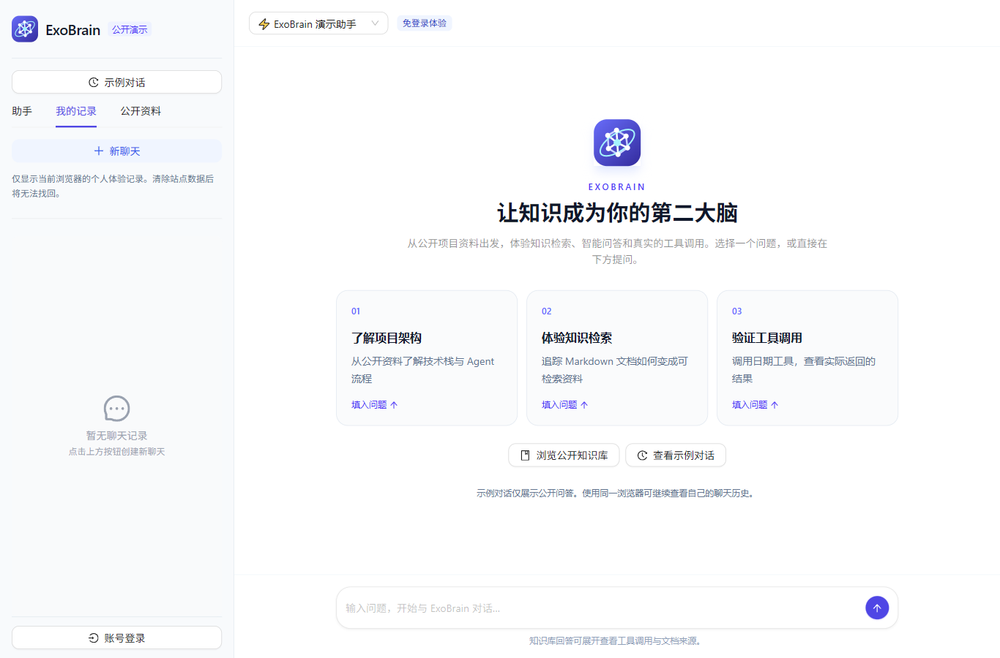
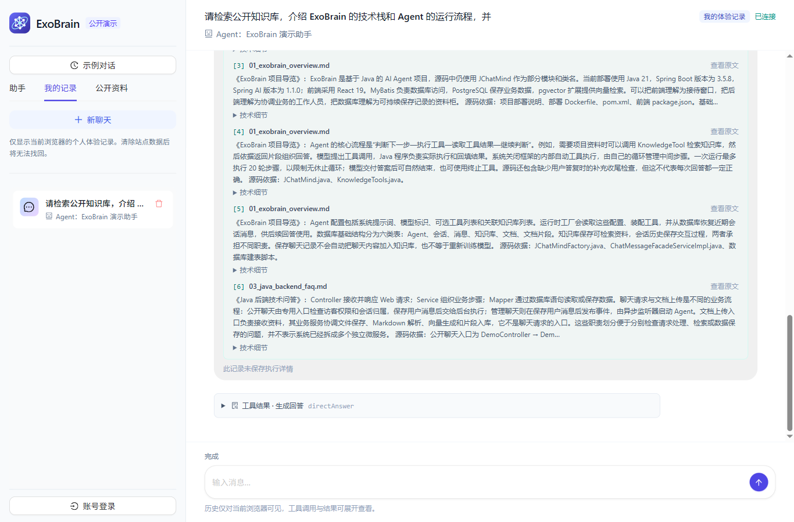
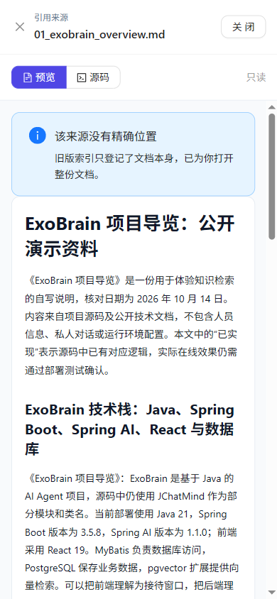

# 2026-10-19 线上访客体验基线

观察日期采用北京时间。站点：https://exobrain.sharmoon.cc.cd/ 。本页记录事实及范围，不代表整站性能或所有问题的质量。

## 1. 实际浏览器路径

独立 Chromium 游客会话，桌面 1366×900、移动 390×844。点击首页「了解项目架构」，卡片先填入问题，随后手动发送：

> 请检索公开知识库，介绍 ExoBrain 的技术栈和 Agent 的运行流程，并注明文档来源。

通过页面文本变化观察时间：

| 从点击发送起 | 观察 |
| --- | --- |
| 0.767 秒 | 开始显示「正在思考下一步动作」 |
| 5.912 秒 | 显示执行工具状态 |
| 9.428 秒 | 检索结果后再次显示思考 |
| 19.752 秒 | 首次出现最终答案正文 |

最终正文 `innerText.length = 1655`，附 6 条来源。内容整段出现，视口自动落到来源列表底部。运行读取多次返回 Nginx HTML 404，界面显示「此记录未保存执行详情」。

打开第 3 条来源后能读取原文，但出现「该来源没有精确位置」「旧版索引只登记了文档本身，已为你打开整份文档」。公开原文仍将正文级索引与结构化来源列为继续研究方向。

移动页宽、main clientWidth 和 main scrollWidth 均为 390px。本次未观察到首页横向溢出；主要问题是信息层次与首屏入口。

## 2. 只读核对的配置与代码

- 仓库 HEAD：`09e9982aa4a2678b913ef6889fce1c73aa4f88ef`。
- 有效网关：`/etc/nginx/sites-available/exobrain`，启用链接为 `/etc/nginx/sites-enabled/exobrain`。
- 网关文件 SHA-256：`0a5964be2120e2284562cf8bef403a52b32e483b266b347309527a3bbfe6aa33`。
- 已生效前端：`/opt/exobrain/releases/20261018-durable-runs`。
- 网关第 49 行的公开路径白名单不含会话运行列表、单个运行、文档导入状态和取消路径。
- 仓库模板已有前三种读取路径，取消路径尚未包含；后端运行读取与取消 Controller 已存在。
- `RunViews.PublicSummary` 未包含触发/答案消息 ID；现有前端却有依赖该关联的无答案运行展示逻辑，需要补齐访客自身范围的契约。
- `evaluation/tests/test_frozen_assets.py` 明确比较旧版三份公开文件与冻结快照字节，直接重写旧文件会导致测试失败。

这些配置观察只适用于本次核对时刻。实施或发布前再次检查，不应假设其他 agent 在此后没有更新。

## 3. 截图

### 桌面首页

### 回答完成后的实际视口

### 手机来源预览

### 手机首页

## 4. 范围说明

本次真实提交一条游客问题，查看其来源，核对配置与相关源码。没有在线注入故障、修改数据发布范围或进行批量模型对比。故障恢复与性能分布需要实施后按验收方案补充。

原始记录保存在本机 `E:/ali-ssh/output/playwright/exobrain-ux-20261019-audit.md`。本目录已复制可公开的截图并核对字节一致，不包含访客 Cookie、凭据或私密浏览器状态。
